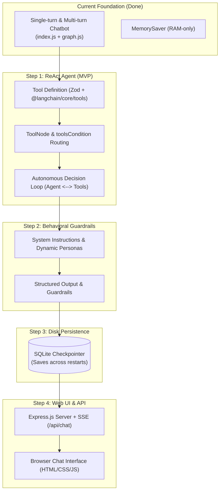

# 🗺️ Agent Evolution Roadmap: Master Tracklist

This master tracklist outlines the core progression milestones to evolve your **LangGraph + Gemini** project from a basic conversational chatbot into a full-fledged autonomous agent.

---

## 📋 Progression Overview

| Step | Milestone | Goal | Status | Detailed Guide |
| :---: | :--- | :--- | :---: | :--- |
| **Step 1** | **ReAct Agent & Tool Calling (MVP)** | Give Gemini action tools (calculator, search/mock APIs) so it can execute code and retrieve data autonomously. | 🟡 **In Progress** | [`STEP1_TOOL_AGENT_TRACKLIST.md`](file:///d:/LLM's/ai_one/STEP1_TOOL_AGENT_TRACKLIST.md) |
| **Step 2** | **System Prompts & Behavioral Guardrails** | Define strict agent personas, operational boundaries, and structured output formatting. | ⚪ *Upcoming* | *Pending Step 1 completion* |
| **Step 3** | **Persistent SQLite Memory Checkpointer** | Replace RAM-only storage with a persistent SQLite database so sessions survive process restarts. | ⚪ *Upcoming* | *Pending Step 2 completion* |
| **Step 4** | **Web UI & Streaming API Service** | Move beyond terminal CLI to an Express.js backend with Server-Sent Events (SSE) and an interactive web chat interface. | ⚪ *Upcoming* | *Pending Step 3 completion* |

---

## 🗺️ Architectural Milestone Map

---

## 📌 Milestone Summaries

### 🛠️ Step 1: ReAct Agent & Tool Calling (MVP)
* **Objective:** Enable Gemini to decide *when* it needs to fetch external data or run calculations, call the appropriate tool, receive the observation, and synthesize a final response.
* **Key Components:**
  * `@langchain/core/tools` (`tool` helper) & `zod` for parameter validation schemas.
  * `@langchain/langgraph/prebuilt` (`ToolNode` and `toolsCondition`).
  * ReAct cycle: `START -> agent -> (toolsCondition) -> tools -> agent -> END`.
* **Actionable Tracklist:** 👉 Follow the step-by-step workbook in [`STEP1_TOOL_AGENT_TRACKLIST.md`](file:///d:/LLM's/ai_one/STEP1_TOOL_AGENT_TRACKLIST.md).

---

### 🎭 Step 2: System Prompts & Behavioral Guardrails
* **Objective:** Establish the agent's identity, role instructions, tone, and guardrails to prevent hallucinations and off-topic queries.
* **Key Components:**
  * `SystemMessage` injection into the model node.
  * Context-aware instructions based on thread configuration.
  * Error recovery and graceful failure formatting.

---

### 💾 Step 3: Persistent SQLite Memory Checkpointer
* **Objective:** Upgrade from in-memory `MemorySaver` to a disk-backed SQLite database.
* **Key Components:**
  * `@langchain/langgraph-checkpoint-sqlite` package.
  * Persistent file database (`./agent_memory.db`).
  * Thread resumption across terminal restarts.

---

### 🌐 Step 4: Web UI & Streaming API Service
* **Objective:** Transition from terminal CLI to a web-based chat application with real-time streaming and tool visibility.
* **Key Components:**
  * Express.js HTTP backend server.
  * Server-Sent Events (SSE) `/api/chat` endpoint piping `app.streamEvents()`.
  * Modern HTML5/CSS/JavaScript web frontend with chat bubbles and tool execution badges.

---

## 🚀 Current Focus
👉 Proceed immediately to [`STEP1_TOOL_AGENT_TRACKLIST.md`](file:///d:/LLM's/ai_one/STEP1_TOOL_AGENT_TRACKLIST.md) to start building Step 1!

