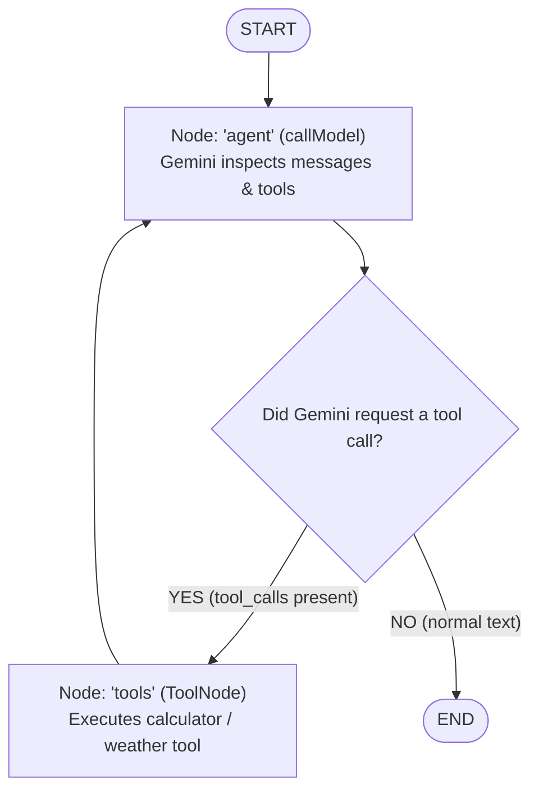

# 🛠️ Step 1 Manual Coding Tracklist: Tool-Calling ReAct Agent MVP

Welcome to **Step 1** of your AI Agent evolution! In this tracklist, you will transform your basic conversational chatbot into an **autonomous ReAct (Reason + Act) agent** that can call custom tools, process data, and answer questions using external computation.

---

## 📋 Step 1 Tracklist Overview

- [ ] **Step 1.1:** Import Tool Utilities (`tool`, `z`, `ToolNode`, `toolsCondition`)
- [ ] **Step 1.2:** Define Action Tools with Zod Validation Schemas
- [ ] **Step 1.3:** Bind Tools to Gemini Model (`llm.bindTools`)
- [ ] **Step 1.4:** Update the Model Execution Node (`callModel`)
- [ ] **Step 1.5:** Construct `ToolNode` and Update Graph Nodes
- [ ] **Step 1.6:** Add Conditional Edge (`toolsCondition`) & ReAct Loop
- [ ] **Step 1.7:** Re-compile the Graph with `MemorySaver`
- [ ] **Step 1.8:** Update CLI (`index.js`) to Display Tool Invocations
- [ ] **Step 1.9:** Run Verification Scenarios & Multi-Turn Tests

---

## 🧠 Mental Model: The ReAct (Reason + Act) Cycle

In a standard chatbot, the LLM immediately replies to the user. In a **ReAct Agent**, the LLM can pause and invoke a tool first:



1. **User asks:** `"What is 45 * 12 + 350?"`
2. **Agent thinks:** *"I have a `calculator` tool. I'll invoke it with `expression: '45 * 12 + 350'`."*
3. **`toolsCondition`:** Detects `tool_calls` on the AI message and routes to `'tools'`.
4. **`ToolNode`:** Runs the JavaScript function and returns a `ToolMessage` with the result `890`.
5. **Agent synthesizes:** The graph routes back to `'agent'`. Gemini reads the result `890` and replies: *"45 * 12 + 350 is 890."*
6. **`toolsCondition`:** No more tools needed; routes to `END`.

---

## 🧱 Step 1.1: Import Tool Utilities

### 🎯 Goal
Ensure all tool abstractions and graph prebuilts are imported in [`graph.js`](file:///d:/LLM's/ai_one/graph.js).

### 📝 What to Import in `graph.js`
At the top of [`graph.js`](file:///d:/LLM's/ai_one/graph.js), add imports for:
* `tool` from `@langchain/core/tools`
* `z` from `zod`
* `ToolNode` and `toolsCondition` from `@langchain/langgraph/prebuilt`

```javascript
import { tool } from "@langchain/core/tools";
import { z } from "zod";
import { ToolNode, toolsCondition } from "@langchain/langgraph/prebuilt";
```

- [ ] **Check when done:** Imports added to `graph.js`.

---

## 🧰 Step 1.2: Define Action Tools with Zod Schema

### 🎯 Goal
Create 2 clear, lightweight tools for the MVP:
1. `calculator`: Computes arithmetic expressions safely.
2. `getWeather`: Returns mock weather reports for specified cities.

### 📝 Code to Add in `graph.js`
```javascript
// --- Tool Definitions ---

// 1. Calculator Tool
export const calculatorTool = tool(
  async ({ expression }) => {
    try {
      // Safe evaluation for basic math: numbers, +, -, *, /, %, parenthesis, spaces
      if (!/^[0-9+\-*/().\s%]+$/.test(expression)) {
        return "Error: Invalid characters in arithmetic expression.";
      }
      const result = Function(`"use strict"; return (${expression})`)();
      return String(result);
    } catch (err) {
      return `Error evaluating expression: ${err.message}`;
    }
  },
  {
    name: "calculator",
    description: "Useful for performing mathematical calculations and evaluating arithmetic expressions.",
    schema: z.object({
      expression: z.string().describe("The mathematical expression to evaluate, e.g. '45 * 12 + 350'"),
    }),
  }
);

// 2. Weather Lookup Tool (Mock Service for MVP)
export const weatherTool = tool(
  async ({ city }) => {
    const cityLower = city.toLowerCase().trim();
    const mockWeather = {
      tokyo: "Sunny, 22°C (72°F) with light breeze",
      london: "Rainy, 14°C (57°F) with high humidity",
      "new york": "Partly cloudy, 18°C (64°F)",
      paris: "Mild, 19°C (66°F)",
      mumbai: "Warm and humid, 32°C (90°F)",
    };

    if (mockWeather[cityLower]) {
      return `Current weather in ${city}: ${mockWeather[cityLower]}`;
    }
    return `Current weather in ${city}: Clear skies, 24°C (75°F) (estimated).`;
  },
  {
    name: "getWeather",
    description: "Get the current weather conditions for a specified city.",
    schema: z.object({
      city: z.string().describe("The name of the city, e.g. 'Tokyo' or 'London'"),
    }),
  }
);

export const tools = [calculatorTool, weatherTool];
```

- [ ] **Check when done:** `calculatorTool`, `weatherTool`, and `tools` array defined in `graph.js`.

---

## 🔗 Step 1.3: Bind Tools to the Gemini Model

### 🎯 Goal
Inform Gemini about available tools so it knows their names, descriptions, and input parameters.

### 📝 Code Update in `graph.js`
Bind the tools array to your initialized `ChatGoogleGenerativeAI`:

```javascript
// Initialize Gemini Model
export const llm = new ChatGoogleGenerativeAI({
  model: process.env.GEMINI_MODEL || "gemini-3.8-flash",
  apiKey: process.env.GOOGLE_API_KEY || process.env.GEMINI_API_KEY,
  temperature: 0, // Lower temperature (0) is recommended for precise tool calling
});

// Bind tools to the model
export const modelWithTools = llm.bindTools(tools);
```

- [ ] **Check when done:** `modelWithTools` created with `.bindTools(tools)`.

---

## 🤖 Step 1.4: Update the Model Execution Node (`callModel`)

### 🎯 Goal
Update `callModel` to invoke `modelWithTools` instead of the raw `llm`.

### 📝 Code Update in `graph.js`
```javascript
export async function callModel(state) {
  // Invokes Gemini with all messages and the bound tool schemas
  const response = await modelWithTools.invoke(state.messages);
  return { messages: [response] };
}
```

- [ ] **Check when done:** `callModel` invokes `modelWithTools.invoke(state.messages)`.

---

## 🕸️ Step 1.5 & 1.6: Build the ReAct Graph with `ToolNode` and `toolsCondition`

### 🎯 Goal
Connect the `agent` node and `tools` node with conditional routing so Gemini can call tools and loop back.

### 📝 Code Update in `graph.js`
```javascript
// 4. Construct the Workflow Graph
const toolNode = new ToolNode(tools);

const workflow = new StateGraph(StateAnnotation)
  .addNode("agent", callModel)
  .addNode("tools", toolNode)
  .addEdge(START, "agent")
  // Conditional Edge: If agent produced tool_calls -> route to 'tools', otherwise route to END
  .addConditionalEdges("agent", toolsCondition)
  // Edge: After tools execute, always route back to 'agent' to synthesize response
  .addEdge("tools", "agent");
```

### 🧠 Why this loop works
* `toolsCondition` is a prebuilt helper from LangGraph. It checks the latest message in state:
  * If `message.tool_calls` is non-empty $\rightarrow$ returns `"tools"`.
  * If `message.tool_calls` is empty $\rightarrow$ returns `END`.
* When the `"tools"` node finishes, the edge `.addEdge("tools", "agent")` sends the graph back to `"agent"` so Gemini can review the tool results!

- [ ] **Check when done:** `toolNode` created, `addConditionalEdges("agent", toolsCondition)` and `addEdge("tools", "agent")` connected.

---

## 💾 Step 1.7: Re-compile Graph with Checkpointer

### 🎯 Goal
Ensure graph compilation maintains session state so multi-turn memory works seamlessly alongside tool calls.

### 📝 Code in `graph.js`
```javascript
// 5. Compile with In-Memory Checkpointer
export const checkpointer = new MemorySaver();
export const app = workflow.compile({ checkpointer });
```

- [ ] **Check when done:** `app` compiled with `checkpointer`.

---

## 💻 Step 1.8: Update CLI (`index.js`) to Display Tool Calls

### 🎯 Goal
When Gemini decides to use a tool, display a visual status indicator in the terminal (e.g. `🔧 Using tool: calculator...`) so the user knows what action is happening behind the scenes before the final answer streams.

### 📝 Code Update in `index.js`
Inside the `for await (const event of eventStream)` loop in [`index.js`](file:///d:/LLM's/ai_one/index.js):

```javascript
      for await (const event of eventStream) {
        // 1. Detect when the tool node starts executing
        if (event.event === "on_tool_start") {
          console.log(`\n🔧 [Tool Invoked: ${event.name}]`);
        }
        // 2. Detect when the tool finishes
        if (event.event === "on_tool_end") {
          console.log(`✔️ [Tool Output Received]\n`);
          process.stdout.write("AI  > ");
        }
        // 3. Stream regular text response chunks
        if (event.event === "on_chat_model_stream" && event.data?.chunk?.content) {
          process.stdout.write(event.data.chunk.content);
        }
      }
      console.log("\n");
```

- [ ] **Check when done:** `index.js` updated to log tool execution events.

---

## 🧪 Step 1.9: Run Verification Scenarios

Run your application:
```bash
npm start
```

### 🧪 Test Scenarios:

#### Test A: Normal Conversational Message (No Tool Needed)
* **Prompt:** `Hi, what is your role?`
* **Expected:** No tool indicators appear; Gemini answers directly.

#### Test B: Math Calculation Tool Triggered
* **Prompt:** `What is 234 * 56 + 1890?`
* **Expected:** 
  1. Terminal shows `🔧 [Tool Invoked: calculator]`
  2. Terminal shows `✔️ [Tool Output Received]`
  3. Gemini streams: `"234 * 56 + 1890 = 14994"` (accurate math computed by JavaScript, not hallucinated).

#### Test C: Weather Lookup Tool Triggered
* **Prompt:** `How is the weather in Tokyo right now?`
* **Expected:** 
  1. Terminal shows `🔧 [Tool Invoked: getWeather]`
  2. Terminal shows `✔️ [Tool Output Received]`
  3. Gemini responds with the mock weather data for Tokyo.

#### Test D: Multi-Turn Memory + Tool Follow-up
* **Prompt 1:** `What is 100 divided by 4?` (Agent uses calculator $\rightarrow$ 25).
* **Prompt 2:** `Now multiply that answer by 5.` (Agent remembers 25 from conversation history $\rightarrow$ calculates $25 \times 5 = 125$).

- [ ] **Check when done:** All 4 verification scenarios succeed!

