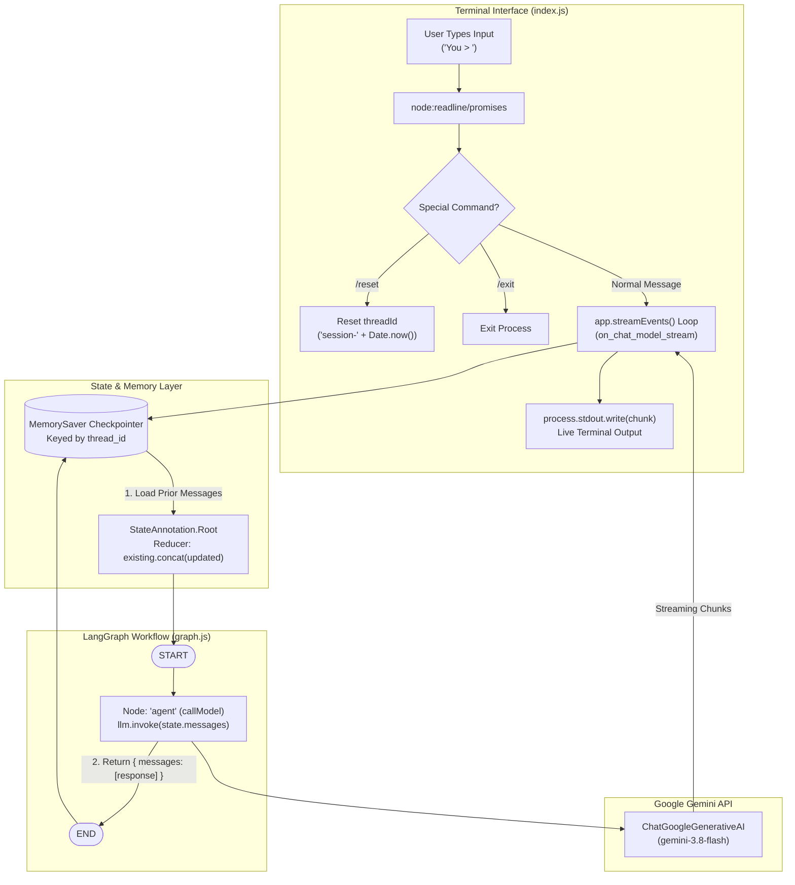

# 🧠 Architecture Walkthrough & Mastery Guide: LangGraph + Gemini Chatbot

Congratulations! You have manually built, verified, and run a stateful, streaming conversational AI agent using **LangGraph** and **Google Gemini**.

This guide is your deep-dive manual to revisit again and again. It details exactly what happens under the hood on every keystroke, explains the core mental models of LangGraph, and outlines how to upgrade and improve your application.

---

## 🗺️ High-Level System Architecture



---

## 🔍 The Lifecycle of a Single Message (Step-by-Step)

When you type `"What is my favorite food?"` into the terminal and press Enter, here is the exact chronological sequence of events:

### 1. The Entrypoint: `index.js`
1. **Input Capture:** `readline/promises` pauses execution until you press Enter, then returns the input string.
2. **Command Parsing:** It inspects if the string matches `/reset` or `/exit`.
3. **Payload Construction:** It wraps the plain string into a LangChain primitive: `new HumanMessage("What is my favorite food?")`.
4. **Configuration Dispatch:** It passes two parameters to `app.streamEvents(...)`:
   - State Input: `{ messages: [new HumanMessage(...)] }`
   - Config: `{ configurable: { thread_id: "session-17298..." }, version: "v2" }`

---

### 2. The Checkpointer & State Reducer
Before running any code in your graph:
1. **Thread Lookup:** LangGraph asks `MemorySaver`: *"Do we have any saved state for `thread_id: session-17298...`?"*
2. **State Hydration:** 
   - If it's a new conversation, `state.messages` starts empty (`default: () => []`).
   - If previous turns exist, `MemorySaver` loads all past `HumanMessage` and `AIMessage` objects.
3. **Reducer Invocation:** LangGraph runs your reducer:
   ```javascript
   reducer: (existing, updated) => existing.concat(updated)
   ```
   It appends your new `HumanMessage` to the loaded conversation array.

---

### 3. The Node Execution: `callModel` in `graph.js`
1. Execution routes from `START` directly to the `"agent"` node (`callModel`).
2. Inside `callModel(state)`:
   ```javascript
   const response = await llm.invoke(state.messages);
   ```
   Notice that `state.messages` contains the **entire conversation history**, not just the latest message! This is why Gemini knows what you said earlier.
3. The prompt is sent to Google's Generative Language API using your `GOOGLE_API_KEY`.

---

### 4. Real-Time Streaming & Event Bus
Because `index.js` invoked `app.streamEvents(..., { version: "v2" })`:
1. LangGraph emits fine-grained events as the graph executes:
   - `on_chain_start`
   - `on_chat_model_start`
   - `on_chat_model_stream` 👈 *(Generated every time a word/sub-word chunk arrives from Gemini)*
   - `on_chat_model_end`
   - `on_chain_end`
2. `index.js` intercepts `on_chat_model_stream`:
   ```javascript
   if (event.event === "on_chat_model_stream" && event.data?.chunk?.content) {
       process.stdout.write(event.data.chunk.content);
   }
   ```
   This flushes tokens directly to your terminal screen in real-time.

---

### 5. Checkpointing & State Persistence
1. When Gemini finishes generating the full response, `callModel` returns:
   ```javascript
   return { messages: [response] };
   ```
2. The reducer runs again, appending the new `AIMessage` to `state.messages`.
3. The graph reaches `END`.
4. `MemorySaver` automatically saves the updated message list under `threadId`.
5. The terminal prints a newline `\n` and waits for your next input `You > `.

---

## 💡 Core Mental Models in LangGraph

### 1. Why use a "Graph" instead of a simple `while` loop?
In simple apps, a basic array in memory works. But in real-world AI applications:
- **Cycles & Branching:** An agent needs to decide: *"Do I have enough info? Should I query a database, search Google, or answer the user?"*
- **State Isolation:** Each session or user has an isolated state thread that can be paused, inspected, or resumed.
- **Resilience:** If an LLM call fails halfway, a graph checkpoint lets you inspect where it failed without losing user context.

### 2. State & Channels (Annotations)
Think of `Annotation.Root` as a database table schema for your agent.
- Each property inside `Annotation.Root` is a **channel**.
- When a node returns `{ messages: [...] }`, it doesn't replace the entire state object—it only publishes an update to the `messages` channel.
- The `reducer` defines how that update merges with what was already in the channel.

---

## 🚀 How to Improve & Level Up This Project

Now that your MVP works smoothly, here are the next four high-impact upgrades:

### Upgrade 1: System Prompts (Personas & Constraints)
Give your chatbot a defined personality, tone, or strict instructions.
In [`graph.js`](file:///d:/LLM's/ai_one/graph.js):
```javascript
import { SystemMessage } from "@langchain/core/messages";

// You can prepend a SystemMessage into the callModel node:
export async function callModel(state) {
  const systemPrompt = new SystemMessage(
    "You are Jarvis, a concise and highly technical coding assistant. Keep responses punchy and code-focused."
  );
  const response = await llm.invoke([systemPrompt, ...state.messages]);
  return { messages: [response] };
}
```

---

### Upgrade 2: Tools & Function Calling (ReAct Agent)
Give Gemini the ability to take actions (e.g., check the current weather, execute JavaScript code, or search the web):
1. Define a tool using `@langchain/core/tools`.
2. Bind the tool to the model: `const modelWithTools = llm.bindTools([myTool]);`.
3. Add a tool execution node and conditional edges in LangGraph to create a true autonomous agent.

---

### Upgrade 3: Persistent Database Storage (SQLite / Postgres)
Currently, `MemorySaver` stores sessions in RAM. If you stop the Node process (`Ctrl+C`), memory resets.
- You can replace `new MemorySaver()` with `@langchain/langgraph-checkpoint-sqlite` or PostgreSQL.
- Then, even if you restart your computer, typing the same `thread_id` will resume the conversation right where you left off!

---

### Upgrade 4: Web UI / REST API
Turn this CLI into a full web application:
- Expose an Express.js or Fastify server with a `/chat` endpoint.
- Stream Server-Sent Events (SSE) to a clean browser frontend (HTML/CSS/JS) with chat bubbles.
